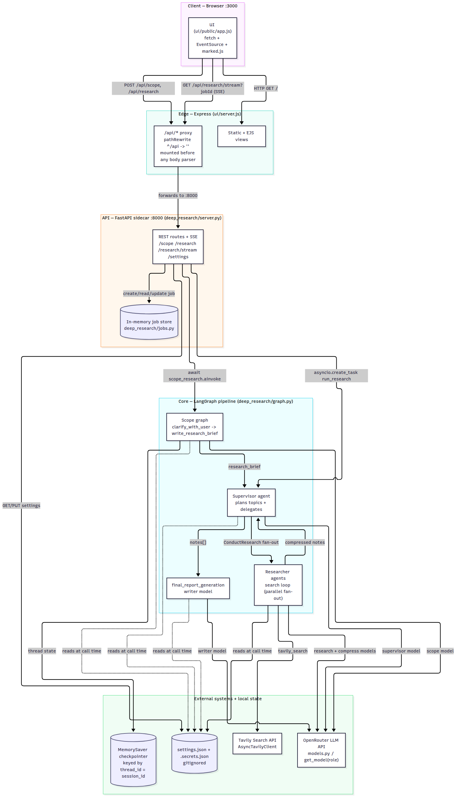
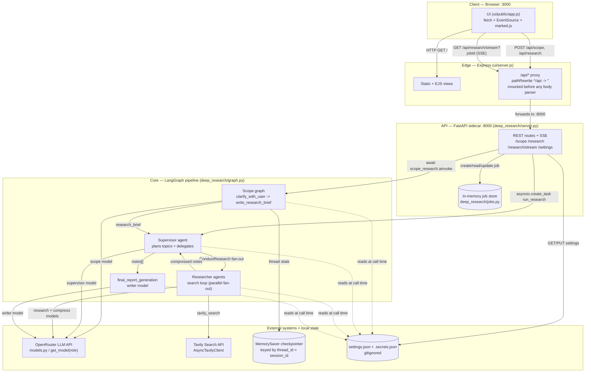
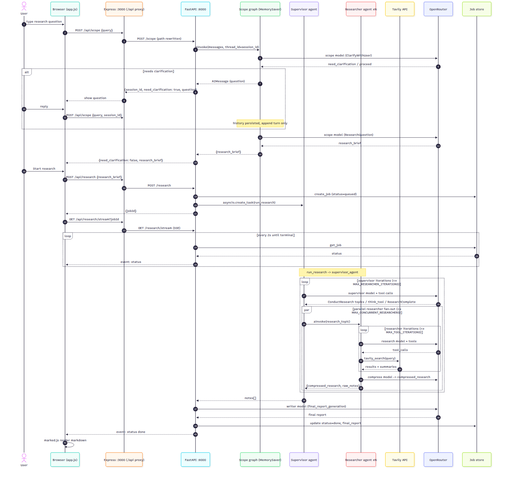
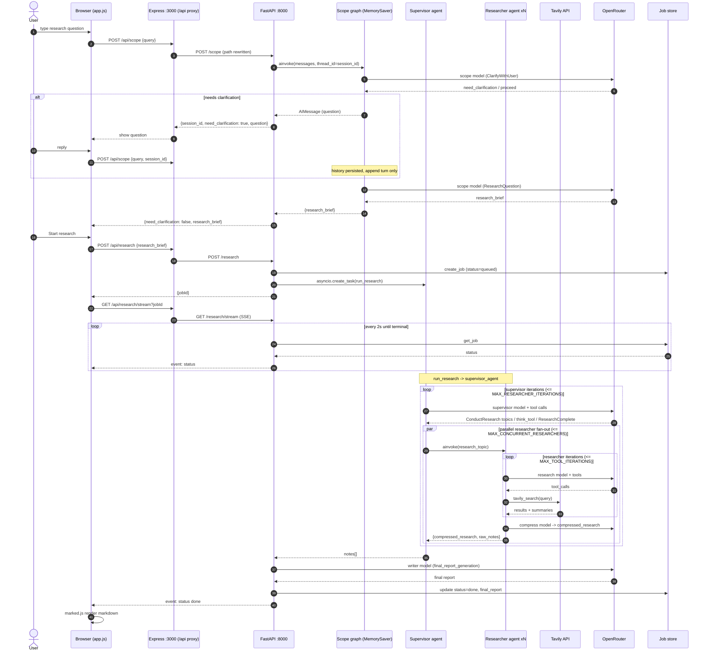
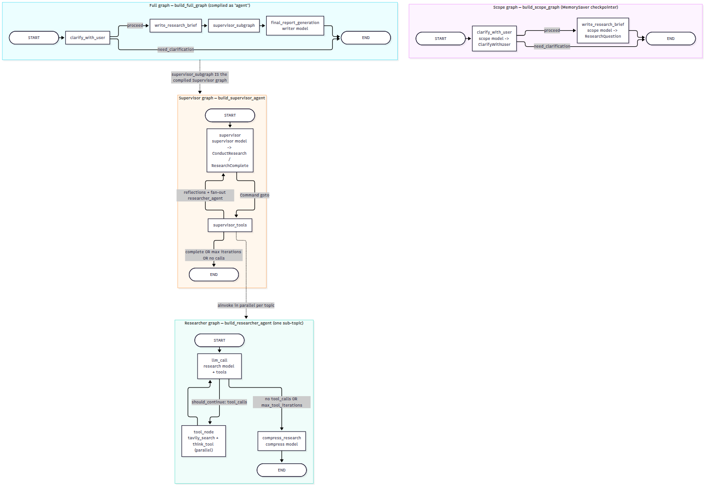
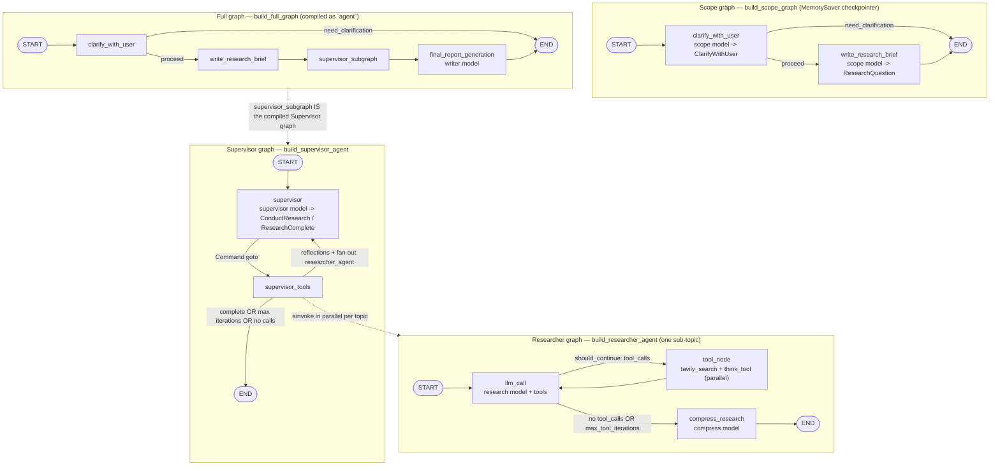
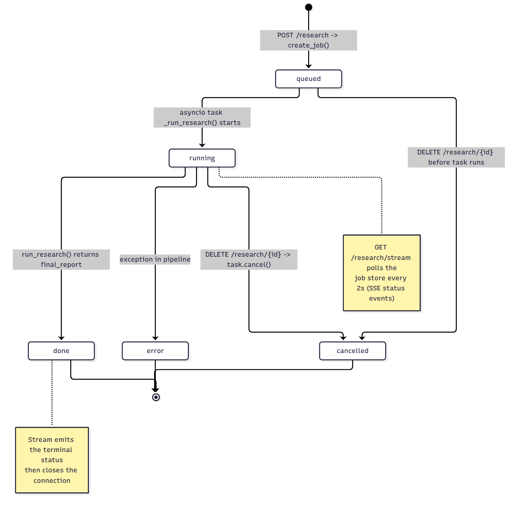
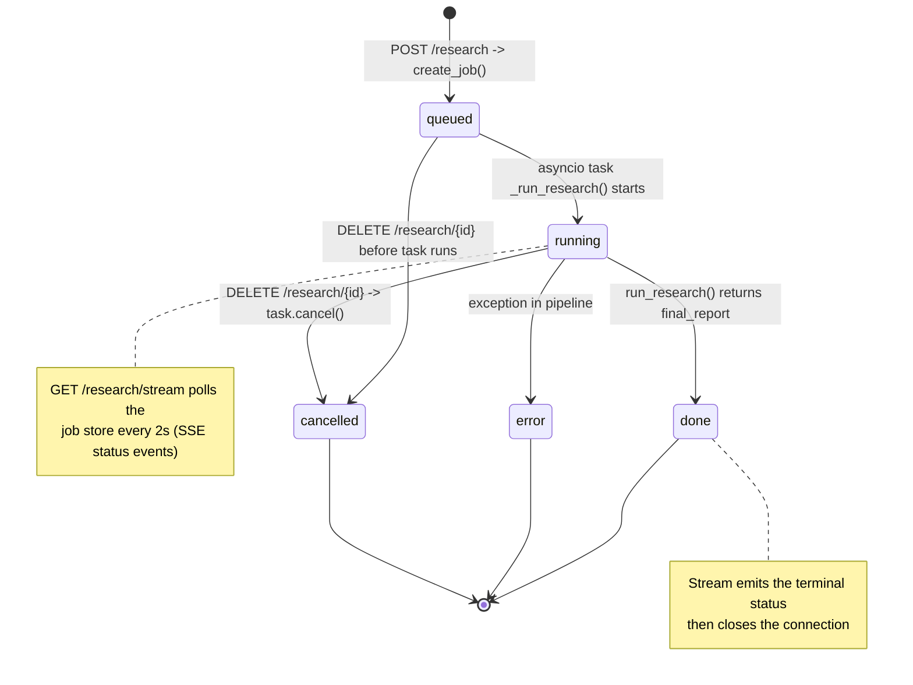
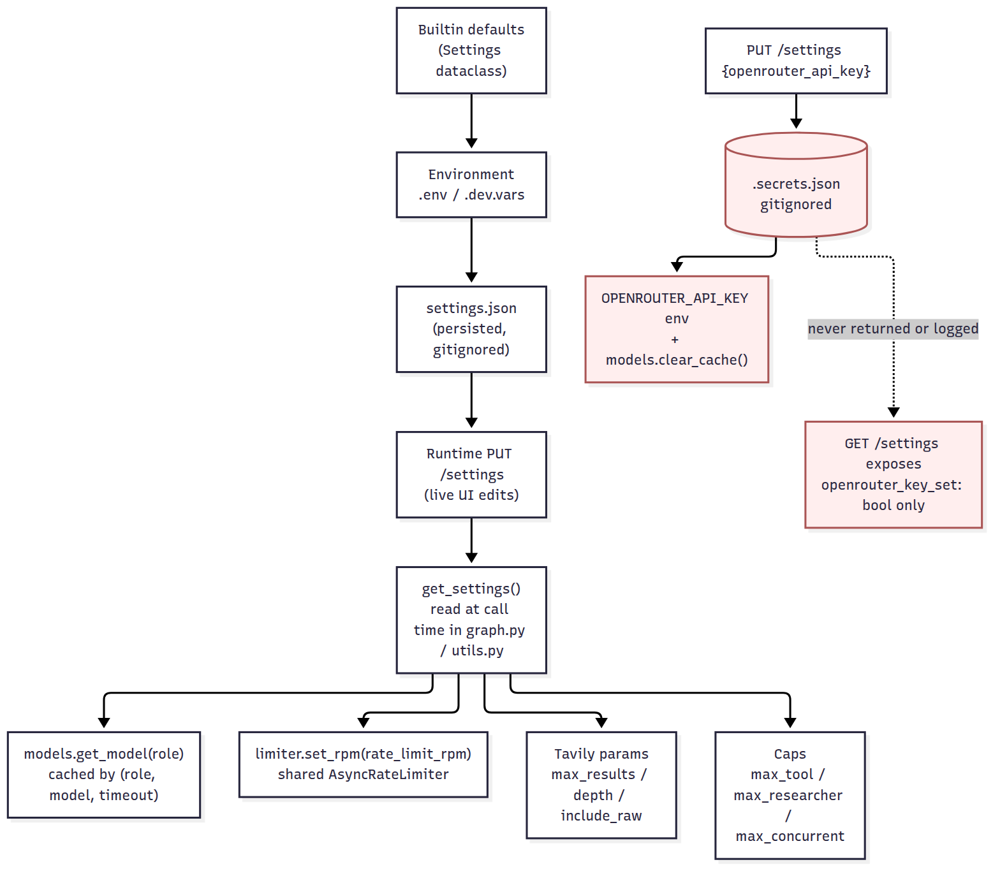
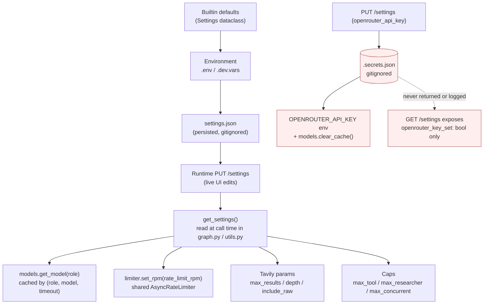

# Deep Research

A local, single-user deep research agent: a LangGraph multi-agent pipeline
(scope -> supervisor -> parallel researchers -> final report) wrapped in a
FastAPI sidecar and a Bootstrap web UI.

## Pipeline

```
Browser (:3000, Bootstrap 5)
  -> Express ui/server.js (static + /api/* proxy)
    -> FastAPI deep_research/server.py (:8000, transport-only)
      -> deep_research/graph.py (single source of graph truth)
         -> scope graph: clarify_with_user -> write_research_brief  [MemorySaver session]
         -> supervisor_agent -> researcher_agent (AsyncTavilyClient)
         -> final_report_generation
```

All nodes are async and all network I/O uses `AsyncTavilyClient` + `ainvoke`,
so the event loop is never blocked.

## Architecture diagrams

Mermaid sources and rendered PNGs live in [`docs/architecture/`](docs/architecture/).

### 1. System context — who talks to whom



<details>
<summary>Mermaid source</summary>



</details>

### 2. End-to-end research sequence



<details>
<summary>Mermaid source</summary>



</details>

### 3. LangGraph topology



<details>
<summary>Mermaid source</summary>



</details>

### 4. Job lifecycle



<details>
<summary>Mermaid source</summary>



</details>

### 5. Settings precedence and secrets



<details>
<summary>Mermaid source</summary>



</details>

## Requirements

- Python 3.11+
- Node 20+
- `uv` (used by `run.sh` to manage the venv) or plain `pip`
- A Tavily API key; an OpenRouter key (preferred) or direct OpenAI/Anthropic keys

## Setup

```bash
cp .env.example .env      # then fill in your keys
pip install -e .          # or: uv pip install -e .
npm --prefix ui install
```

Minimal `.env`:

```bash
TAVILY_API_KEY=...
OPENROUTER_API_KEY=...    # preferred: all models route via OpenRouter
MODEL=liquid/lfm-2.5-2.6b:free
```

See `.env.example` for per-role model overrides, timeouts, and research caps.

`.env` is listed in `.gitignore`, so your keys stay local. Only `.env.example`
(placeholders) is committed — never put real keys there.

## Getting API keys

You need two keys. Both plans have a free tier; a small OpenRouter top-up removes
the free-tier daily cap.

### 1. Tavily (web search)

1. Sign up at <https://app.tavily.com/>.
2. Open your dashboard and copy an API key (**API Keys** section).
3. Add it to `.env`:

   ```bash
   TAVILY_API_KEY=tvly-dev-...
   ```

Tavily's free plan includes **1,000 credits/month** (no card required), resetting
on the 1st of each month. A *development* key allows up to 100 requests/min.

### 2. OpenRouter (models)

1. Sign up at <https://openrouter.ai/>.
2. Create a key at <https://openrouter.ai/keys> and copy it (`sk-or-v1-...`).
3. Add it to `.env`:

   ```bash
   OPENROUTER_API_KEY=sk-or-v1-...
   ```

**Raise the free-model daily limit:** by default, `:free` model variants are capped
at **20 requests/min and 50 requests/day**. Topping up your account with **$10+**
of credits (all-time purchases) raises the daily cap to **1,000 requests/day**
(the per-minute limit stays at 20). Top up at <https://openrouter.ai/credits>;
once you've purchased $10+ you keep the higher daily cap even if your balance later
drops below $10.

The default `RATE_LIMIT_RPM=18` in `.env.example` keeps this app just under the
20/min free-model ceiling.

## Run

One command starts the API (`:8000`) and UI (`:3000`), loading `.env` (or
`.dev.vars`):

```bash
./run.sh            # normal
./run.sh --debug    # verbose logs + API auto-reload
```

Then open <http://127.0.0.1:3000> and run the three steps: **Scope -> Research -> Result**.

Manual start:

```bash
PYTHONPATH=. uvicorn deep_research.server:app --port 8000    # API
npm --prefix ui start                                        # UI
```

## CLI

Test the pipeline without the UI (installed as the `deep-research` script via
`pip install -e .`, or run as `python -m deep_research.cli`):

```bash
deep-research scope "best coffee shops in San Francisco"     # scoping only
deep-research research --brief "Compare espresso machines under $500"
deep-research run "state of solid-state batteries in 2026"   # scope + research, interactive
deep-research --log-level DEBUG run "..." --yes              # heavy logs, no prompts
```

- `scope` — prints the clarification question, or the verification + research brief.
- `research` — runs supervisor + final report and prints the report.
- `run` — scopes, prompts for clarification if needed, then runs research.
- `--json` emits machine-readable output; `--log-level` controls verbosity.

Heavy structured logging (start/done + timings + counts per node) goes to
**stderr**, so reports on stdout stay clean. Set `LOG_LEVEL=DEBUG` (or
`--log-level DEBUG`) for per-iteration, per-tool detail. API keys are never logged.

## API

The UI talks to the API through the Express proxy at `/api/*`.

| Method | Path | Body / query | Returns |
| --- | --- | --- | --- |
| GET | `/health` | — | `{ok: true}` |
| POST | `/scope` | `{query, messages?, session_id?}` | `{session_id, need_clarification, question, verification, research_brief}` |
| POST | `/research` | `{research_brief}` | `{jobId}` |
| GET | `/research/{jobId}` | — | job status (`queued\|running\|done\|error\|cancelled`) |
| DELETE | `/research/{jobId}` | — | `{ok: true}` (cancels the task) |
| GET | `/research/stream?jobId=` | — | `text/event-stream` status events |

**Sessions:** the scope graph is compiled with a `MemorySaver` checkpointer.
Pass the returned `session_id` on the next `/scope` call and only the new
`query`; the clarification history is retained across turns. Omit it to start a
new session.

## Configuration

Settings can be set via environment variables (see `.env.example`) or edited live
in the UI **Settings** panel (`GET`/`PUT /api/settings`). Precedence is
`builtin defaults < environment < settings.json < live UI edits`. Runtime edits
persist to `settings.json` (gitignored) and apply to the next run without a
restart (models are resolved per call via `models.get_model(role)`).

The **OpenRouter API key** can also be set in the Settings panel. It is stored in
`.secrets.json` (gitignored) as `OPENROUTER_API_KEY`, never returned by
`GET /settings` (only an `openrouter_key_set` boolean) and never logged; changing
it drops cached model clients so the new key applies immediately.

| Variable | Purpose |
| --- | --- |
| `OPENROUTER_API_KEY` / `OPENROUTER_BASE_URL` | Route every model through OpenRouter |
| `MODEL` | Global default model id |
| `RESEARCH_MODEL`, `SUPERVISOR_MODEL`, `SCOPE_MODEL`, `SUMMARY_MODEL`, `COMPRESS_MODEL`, `WRITER_MODEL` | Per-role overrides |
| `MODEL_TIMEOUT` | Per-call LLM timeout (seconds) |
| `MAX_TOOL_ITERATIONS` | Researcher tool-call cap (default 4) |
| `MAX_RESEARCHER_ITERATIONS` | Supervisor research rounds (default 4) |
| `MAX_CONCURRENT_RESEARCHERS` | Parallel sub-agents per round (default 2) |
| `RATE_LIMIT_RPM` | Outbound LLM requests/minute, provider quota guard (default 18; `0` disables) |
| `TAVILY_MAX_RESULTS`, `TAVILY_SEARCH_DEPTH`, `TAVILY_INCLUDE_RAW`, `TAVILY_TIMEOUT` | Tavily search tuning |
| `API_PORT`, `UI_PORT` | Ports (default 8000 / 3000) |

## Project layout

```
deep_research/        # runtime package (pip install -e .)
  graph.py            # all graphs + checkpointer (single source of truth)
  server.py           # FastAPI: /scope, /research, /research/{id}, /research/stream, /settings
  cli.py              # deep-research CLI (scope / research / run)
  jobs.py             # in-memory job store
  log_config.py       # structured logging + timing helpers
  models.py           # init_model(role) / get_model(role) -> OpenRouter / legacy providers
  settings.py         # runtime tunables (models, caps, rate limit, Tavily); settings.json
  prompts.py          # all prompt templates
  utils.py            # async search + summarization tools
  state_*.py          # graph state schemas
samples/              # unused tutorial material (legacy graphs + notebooks)
ui/                   # Express + Bootstrap UI (proxies /api/* to :8000)
docs/                 # intent, specs, plan, design, test artifacts
  architecture/       # Mermaid diagram sources (.mmd) + rendered PNGs
tests/                # mocked-only search-result suite
```

## Tests

```bash
python -m pytest -q
```

The suite is fully mocked (no network) and covers search-result
dedup/summarization/formatting plus notes extraction.

## Notes

- Localhost only, single user, no auth, no database (in-memory job store).
- Never commit `.env`; keys are never logged or served to the UI.
- `samples/` contains the original tutorial graphs and notebooks. They are not
  imported by the app and still reference the old `deep_research_from_scratch`
  module paths.
